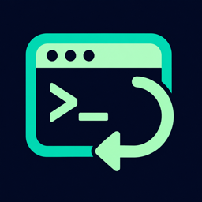
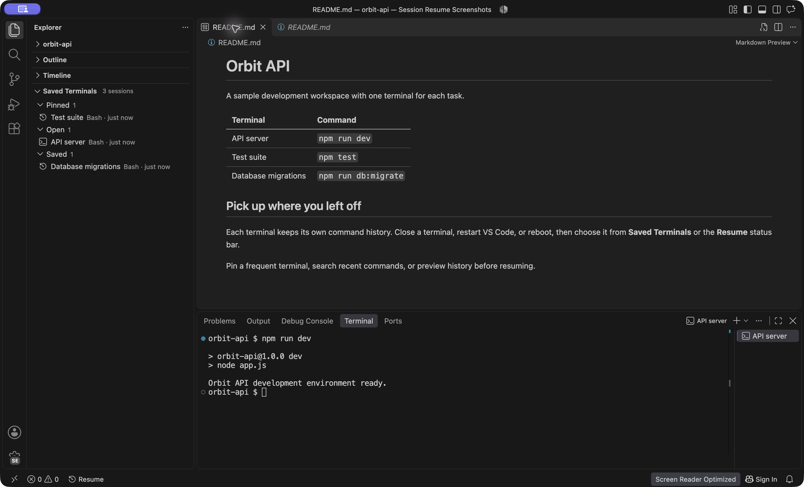
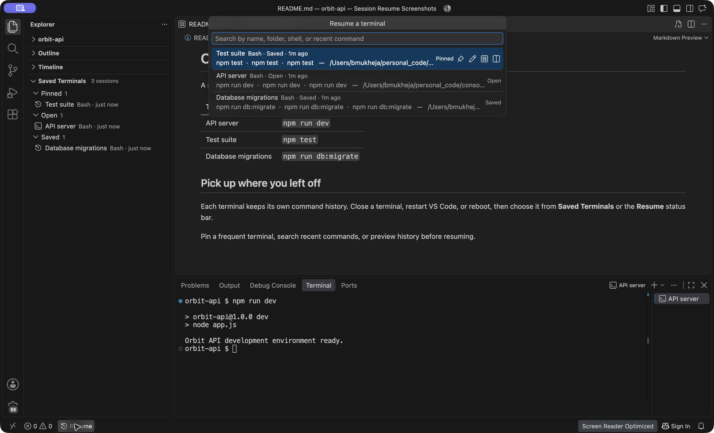
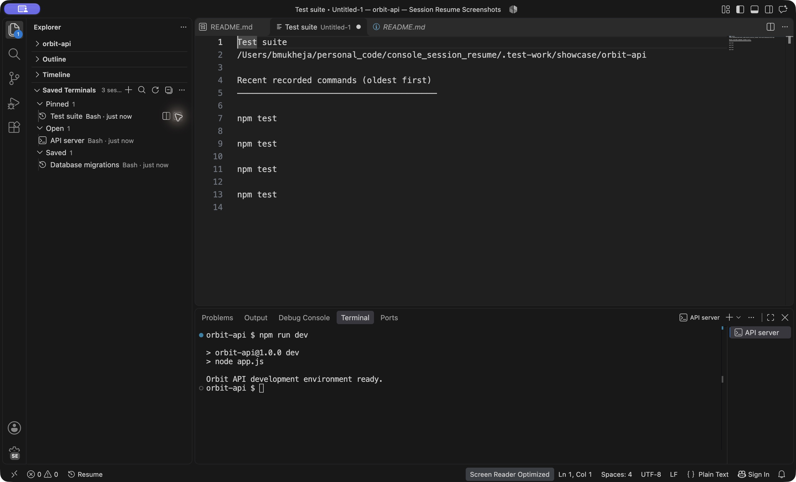

# Console Session Resume



Separate command history for each **native VS Code terminal**, across project closes,
editor restarts, and computer reboots. Uses the shell's normal Up/Down and history
search. No terminal multiplexer or replacement terminal UI.

## Pick up where you left off

Keep an API terminal, a test terminal, and a database terminal with their own histories.
Give them names, pin the ones you use most, and return to the right commands after
closing the project or rebooting.



## Install and use

**Publisher:** `bmukheja` · **Extension ID:** `bmukheja.console-session-resume`

**Requires:** VS Code 1.93 or later and an installed supported shell. This is a preview.

1. Install **Console Session Resume** by **bmukheja** from the Marketplace, or run
   **Extensions: Install from VSIX...** and select the packaged preview
   `console-session-resume-0.3.0.vsix`.
2. Run **Session Resume: Use as Default Terminal** and choose an installed shell.
   This selects its managed profile and enables VS Code's terminal revival on both
   application exit and window close. Existing terminals retain their old profiles.
3. Open new terminals with the normal **+** button. Each gets its own saved history.
   You can also choose another `… (Session Resume)` profile from the terminal menu,
   or run **Session Resume: New Terminal**.
4. Close/reopen the project or reboot and reopen it. If VS Code restores the original
   launch configuration, the tab reuses its history automatically. Otherwise, click
   **Resume** and choose the original saved terminal in that same workspace. This
   also recovers terminals you previously closed.

Only managed terminals are recorded. Commands from before installation cannot be
separated retrospectively from a previously merged global history.

## Finding and resuming terminals

Click **Resume** in the status bar, or run **Session Resume: Resume Saved Terminal**.
The native picker searches terminal names, folders, shells, and the last three
recorded commands. Sessions are grouped as **Pinned**, **Open**, and **Saved** and
show when they were last used. Press Enter to resume a saved terminal or focus a
terminal that is already open.

The **Saved Terminals** section in Explorer provides the same sessions as a native
tree. Click a session to open it. Its context menu offers **Rename**, **Pin/Unpin**,
**Preview Recent Commands**, and **Resume in Split**. The view's menu also includes
**Resume All Saved Terminals**, which skips sessions that are already open.



The picker provides the same actions as buttons on each row. Pinning or renaming
keeps the current search text. A history preview opens a copy of the last 30
recorded commands in an editor; editing that copy does not change shell history.
Previews read existing native history files and preserve the shell's history
exclusion rules. They do not execute commands or create a second command log.



New terminals get names such as `my-project · Bash 1`. The explicit **New Terminal**
command lets you name a terminal, and renaming an open terminal updates both its
native tab and saved entry. Names and pins persist across editor restarts.

## Upgrading from a local VSIX

The Marketplace extension uses the publisher `bmukheja`. If you installed an earlier
`local-tools.console-session-resume` preview, disable that old extension and reload
VS Code before using this version. Saved IDs, terminal names, pins, and histories
are imported automatically from the old storage on the same host. The original
files are preserved. Revived terminals can keep using their old files until closed;
resuming a closed terminal adopts its latest saved history into the new storage.
Close an old terminal in another window before trying to resume it here.

## How it works

The extension assigns a UUID **before launching** a terminal. That UUID and the
history location are in the native terminal's launch environment. When VS Code
preserves that launch configuration, a fresh shell process reuses the same history.
Some VS Code versions/platforms recreate profile terminals with new configurations;
the saved-session picker restores the original UUID and history in that case.
Recovery metadata is stored on disk independently of VS Code's tab snapshot.

| Shell | Native history adapter |
| --- | --- |
| Bash (including macOS Bash 3.2) | Private `HISTFILE`; saves an atomic history snapshot at each prompt. |
| Zsh | Private `HISTFILE`, fresh history context, incremental history saving. |
| Fish | Unique `fish_history` namespace; saves at prompts and before execution. |
| PowerShell 7 / `pwsh` | PSReadLine `HistorySavePath` and `SaveIncrementally`. |
| Windows PowerShell 5.1 | Same PSReadLine adapter; requires PSReadLine. |

PowerShell's `Get-History` remains a record of the current process. Up/Down and
Ctrl+R use the persistent PSReadLine history this extension configures.

Startup profiles and native editing/completion remain available. Existing shell
history exclusion rules still apply. A shell profile that replaces the shell,
disables history, or installs another history manager can require adjustment.

The shell must be installed on the **terminal host**. Native Windows supports
PowerShell and Git Bash; Zsh/Fish run in a WSL or Remote SSH window. Install the
extension on the remote side for Remote SSH / WSL / containers. Classic `cmd.exe`,
`sh`, and legacy shells are not implemented adapters.

## Storage and scope

Session metadata and Bash/Zsh/PowerShell history are stored in this extension's
VS Code global storage directory, outside your projects and outside extension
version directories. On Unix, session directories use mode `0700` and history
files use `0600`. Fish uses its native data directory with a unique `csr_…_history`
file, rather than changing `XDG_DATA_HOME` for your programs.

The saved-session picker is scoped to the workspace file, or to the set of folder
URIs for a folder workspace. Separate projects, worktrees, and remote authorities
remain distinct. Renaming/moving a project changes this lookup scope; existing
revived terminals still refer to their original saved histories.

History is local plaintext, just like ordinary shell history. No network service,
telemetry, command replay, or automatic execution of previous commands is used.

## What survives

- Persisted command history, including normal Up-arrow recall in a fresh process.
- Terminal identity, project association, and the initial/latest available directory.
- Native tab and scrollback restoration through VS Code's own persistence.

Running processes, shell variables, activated environments, and unsaved input do
not survive reboot. Bash saves when the prompt returns: a command still running
at a sudden shutdown may not yet be saved. VS Code's tab restoration can itself
fail or recreate a fresh profile terminal; the saved-session picker does not depend
on that snapshot. Automatic restoration was observed to vary in hosted Windows and
macOS runs of VS Code 1.146.0. Use **Resume** to select the original session.

## Settings

- `sessionResume.shellPaths`: executable overrides, for example
  `{ "bash": "/bin/bash", "pwsh": "/opt/homebrew/bin/pwsh" }`.
- `sessionResume.startupMode`: `auto` (login profiles on macOS, interactive files
  on Linux), `login`, or `interactive`.
- `sessionResume.historySize`: default 20,000 entries for Bash/Zsh/PowerShell.
  Fish manages its own retention.

To undo the default selection, run **Terminal: Select Default Profile** and choose
your previous profile. Uninstalling the extension does not delete saved histories.
No shell startup files are edited by installing this extension.

## Development

The extension runs as plain JavaScript with no runtime npm dependencies.
Development and packaging require Node.js 22 or later and the pinned dev tools.

```bash
npm ci --ignore-scripts
npm test
npm run test:shell
npm run test:vscode
npm run package
npm run verify:package
```

The shell tests use temporary homes and PTYs. They kill the original processes,
start fresh processes, and verify independent histories and native Up-arrow
recall without modifying your actual shell history.

The VS Code test uses a separate `.test-work` user profile, installs the VSIX
there, creates native tabs and a split, quits the editor, and reopens it to verify
that the same histories are restored. It then exercises each installed shell
adapter in real VS Code terminals. A graphical VS Code installation is required.

### Verified behavior

[All seven jobs passed](https://github.com/bharat-mukheja/console_session_resume/actions/runs/43601526055)
on the release candidate, covering unit tests, VSIX contents, native terminal
creation/splits, editor restart, separate histories, command previews, names,
pins, keyboard selection, and resume into a native split.

| Host | VS Code | Native history adapters checked |
| --- | --- | --- |
| Windows | 1.146.0 | Git Bash, PowerShell, Windows PowerShell |
| Linux | 1.146.0 and 1.93.0 | Bash, Zsh, Fish, PowerShell |
| macOS | 1.146.0 | Bash, Zsh, Fish, PowerShell |

The Windows restart check recovered the original histories through Saved Terminals.
Linux and macOS restored them automatically in the final run. Automatic revival
also varied in earlier macOS runs; the saved-session recovery path is independent
of VS Code's tab snapshot. See [validation evidence](docs/validation-0.3.0.md).

All 16 Node tests passed on Windows, Linux, and macOS. POSIX PTY checks exercised
separate shell processes, forced termination, native Up-arrow recall, multiline
Bash commands, and unchanged shared histories. The native tests used temporary
shell homes and separate VS Code profiles. Remote hosts have not been validated.
The physical host was not rebooted; shells and editors were ended and reopened
from their saved files.

## Privacy and support

History stays on the terminal host as plaintext shell history. The extension sends
no commands or telemetry to a server. Shell exclusion rules still apply; avoid
putting credentials in commands you would not want saved.

Read [Privacy](PRIVACY.md), [Support](SUPPORT.md), and [Changes](CHANGELOG.md).
Use the extension's Marketplace **Q & A** tab for support. Licensed under the
[MIT license](LICENSE).
